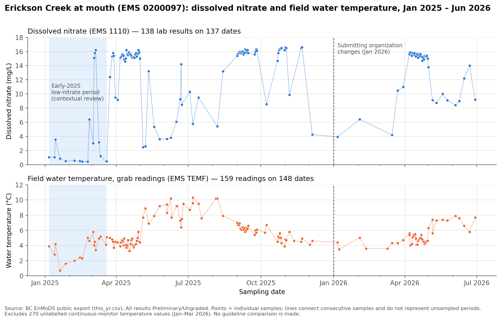
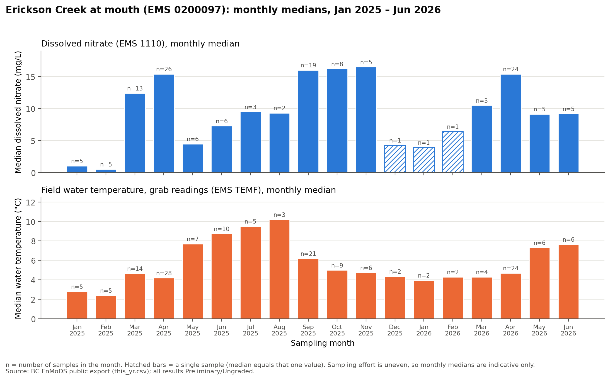
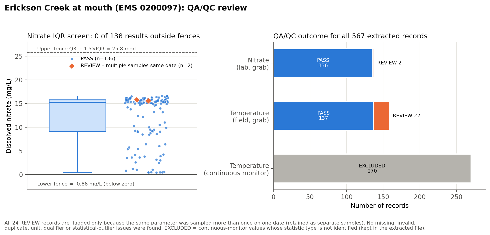

# BC Environmental Monitoring Data QA/QC & Analysis

## Overview

This project takes one monitoring record out of a large public BC Government export and works through a simplified monitoring-data workflow: pull it out of the full file, run documented QA/QC checks, clean it, look at how it changes over time, and report only what the data support. It uses Python (pandas, Matplotlib, a Jupyter notebook) and DuckDB, which queries the 1.9 GB raw CSV without loading it into memory.

The record is dissolved nitrate at Erickson Creek at mouth (EMS site `0200097`), with field water temperature from the same sampling visits as context. It covers January 2025 to June 2026.

The focus is on handling the data carefully, not on modelling. Questionable records are flagged for review rather than deleted, and every output record can be traced back to its row in the raw file.

## Dataset

- **Source:** Government of British Columbia, *Environmental Monitoring Data System (EnMoDS)* results, published on the BC Data Catalogue under the Open Government Licence – British Columbia.
- **Raw file:** `data/raw/this_yr.csv`, the current-year results export.

  | Property | Value |
  |---|---|
  | Size | 1,883,073,291 bytes (about 1.9 GB) |
  | Rows | 3,092,148 |
  | Columns | 67 |
  | Sample dates | 31 Dec 2024 – 19 Sep 2026 |

- The raw file is not in this repository (see `.gitignore`). It was only read, never modified.
- **What the repository contains instead:**
  - `data/selected_monitoring_data.csv`: a 567-record subset with all 67 original columns plus `source_row_number`. Two columns that contain people's names are blanked.
  - `outputs/profiling/`: small summary tables of the full file.
- See [`data/README.md`](data/README.md) for how to obtain the source data.

## Workflow

```
Raw this_yr.csv (~1.9 GB, never modified)
 → schema inspection (header + first 1,000 rows)
 → memory-efficient profiling with DuckDB            scripts/01_profile_raw_dataset.py
 → site/parameter extraction (567 records)           scripts/02_extract_selected_subset.py
 → QA/QC review (PASS / REVIEW / EXCLUDED)           notebook, Sections 7–9
 → cleaning and standardization                      notebook, Section 8
 → summary statistics                                notebook, Section 10
 → temporal analysis and visualization               notebook, Sections 11–13
 → cleaned / flagged / summary outputs               notebook, Section 16
```

**How the site was chosen.** Profiling the whole file found about 6,000 site/parameter pairs with 12 or more sampling dates. These were screened for:

- a single reporting unit
- 5 % or fewer non-detects
- 95 % or more routine (`NORMAL`) samples
- 15 or more sampling months
- 50 or more sampling dates

Erickson Creek nitrate passed, with 137 sampling dates, one unit, no non-detects and one analytical method.

## QA/QC Approach

Every record in the analysis subset gets a `qaqc_flag` and a `qaqc_reason`. Multiple reasons are allowed, separated by `;`.

- PASS: no issue found.
- REVIEW: kept in the data, but needs a human look.
- EXCLUDED: kept in the extracted file but left out of the analysis, with an `exclusion_reason`.

| Check | Rule |
|---|---|
| Missing / malformed date | Blank or unparseable `Observed_Date_Time` |
| Missing / non-numeric result | Blank or non-numeric `Result_Value` |
| Unit consistency | Unit other than mg/L (nitrate) or degC (temperature) |
| Parameter naming | Name differs from the usual name for its EMS code |
| Qualifiers / detection limits / QC type | Detection condition present, result below MDL, or non-routine QC sample |
| True duplicate | Same parameter, timestamp, value, lab sample ID, activity and method |
| Repeated sampling | More than one separate sample on the same date. Flagged for transparency; these are not duplicates. |
| Statistical screen (nitrate) | Outside Tukey's 1.5 × IQR fences |

Suspicious or statistically unusual measurements are kept and flagged, not deleted. An unusual result can reflect:

- real environmental variability
- field or sampling conditions
- analytical variability
- a transcription or data problem
- an unusual event

Telling these apart needs field, lab and site context that this dataset doesn't include. Original result values are never altered; numeric and date versions are added as new columns.

Documented, but not flagged on individual records:

- Change of submitter in January 2026. The submitting organization changed. The detection limit went from 0.005 to 0.025 mg/L, and metadata and timestamp conventions changed. The method and laboratory stayed the same.
- Result status. All results are `Preliminary` and `Ungraded`.

## Analysis

| | Dissolved nitrate (EMS `1110`) | Field water temperature, grab (EMS `TEMF`) |
|---|---|---|
| Site | Erickson Creek at mouth, `0200097` (River, Stream, or Creek) | same |
| Records used | 138 (137 dates) | 159 (148 dates) |
| Date coverage | 2025-01-06 to 2026-06-29 | 2025-01-06 to 2026-06-29 |
| Unit | mg/L (single unit) | °C |
| PASS / REVIEW | 136 / 2 (1.4 %) | 137 / 22 (13.8 %) |
| Min / median / max | 0.426 / 15.25 / 16.6 | 0.7 / 5.0 / 10.3 |
| Mean ± SD | 12.17 ± 5.22 | 5.48 ± 1.80 |

Excluded: 270 continuous-monitor temperature values from Jan–Mar 2026. They come as three unlabelled values per day, so it isn't possible to tell whether each is a minimum, maximum, mean or something else. They are kept in the extracted file.

## Key Findings

- The nitrate record passes every completeness and consistency check. There are no missing, non-numeric, non-detect, unit-inconsistent or duplicated results. All 24 REVIEW flags across both parameters are repeated same-day sampling, which are separate samples and were kept.
- No nitrate result fell outside the 1.5 × IQR fences, which run from −0.88 to 25.81 mg/L.
- The lowest values (0.43–0.47 mg/L) were not isolated. They occurred within a broader low-nitrate period in early 2025: 8 of 10 results in Jan–Feb 2025 were ≤ 1.06 mg/L, and March 2025 alternated between about 0.5 and 16 mg/L within days. These values are retained unchanged and noted for contextual review. The data do not show what caused this period.
- Nitrate was mostly 14–16.6 mg/L. Monthly medians of 15.4–16.5 mg/L were seen in April 2025, September–November 2025 and April 2026. Lower, more variable results occurred in other periods, and the median (15.25) is well above the mean (12.17).
- The pattern may recur seasonally, but I can't confirm that. About 1.5 years of unevenly spaced samples isn't enough.
- Water temperature followed a seasonal cycle. Monthly medians ranged from 2.4 to 10.2 °C, peaking in July–August 2025.
- Nitrate and temperature are essentially uncorrelated in this record. Across 138 exact-timestamp pairs, Pearson r = −0.12 and Spearman ρ = −0.07. This is exploratory and says nothing about cause.

## Outputs

| File | Description |
|---|---|
| `outputs/cleaned_monitoring_data.csv` | 297 analysis records (PASS + REVIEW) with traceability fields, original and numeric results, QA/QC flags, paired temperature |
| `outputs/flagged_records_for_review.csv` | 24 REVIEW records |
| `outputs/site_parameter_summary.csv` | Monitoring statistics per parameter |
| `figures/time_series.png` | Figure 1 – nitrate and temperature over time (stacked panels, shared date axis) |
| `figures/monthly_pattern.png` | Figure 2 – monthly medians with sample counts |
| `figures/qaqc_review.png` | Figure 3 – nitrate IQR screen and QA/QC outcome for all records |
| `outputs/profiling/` | Full-file profiling tables used for site selection |





## Limitations

- Public secondary data: field sheets, chain-of-custody records and lab QC reports were not available.
- All results are `Preliminary` and `Ungraded` and may be revised.
- There is no site, flow, weather or operational context, so the causes of changes can't be determined.
- The record is short (~18 months) and unevenly sampled. Monthly medians are indicative, and some months have a single sample.
- The IQR screen finds unusual values, not errors, and its fences are permissive for this skewed distribution.
- The submitting organization changed in January 2026, along with the detection limit and metadata conventions.
- The export doesn't say whether nitrate is reported as NO3 or NO3-N, so no guideline comparison is made.
- Scope is one site and two parameters. This is an exploratory analysis, not a regulatory compliance assessment.

## Reproducing the Analysis

```bash
pip install -r requirements.txt

# Optional: only if you have the raw export at data/raw/this_yr.csv
python scripts/01_profile_raw_dataset.py      # ~20 s, writes outputs/profiling/
python scripts/02_extract_selected_subset.py  # writes data/selected_monitoring_data.csv

# Main analysis: runs from the committed subset, no raw file needed
jupyter nbconvert --to notebook --execute --inplace BC_Environmental_Monitoring_QAQC_Analysis.ipynb
```

Run everything from the repository root. The extraction and the notebook outputs are deterministic, so re-running them reproduces identical files.

## Repository Structure

```
.
├── README.md
├── requirements.txt
├── .gitignore
├── BC_Environmental_Monitoring_QAQC_Analysis.ipynb
├── data/
│   ├── README.md
│   └── selected_monitoring_data.csv
├── scripts/
│   ├── 01_profile_raw_dataset.py
│   └── 02_extract_selected_subset.py
├── figures/
│   ├── time_series.png
│   ├── monthly_pattern.png
│   └── qaqc_review.png
└── outputs/
    ├── cleaned_monitoring_data.csv
    ├── flagged_records_for_review.csv
    ├── site_parameter_summary.csv
    └── profiling/        (full-file profiling tables)
```

*Data: Contains information licensed under the Open Government Licence – British Columbia.*
